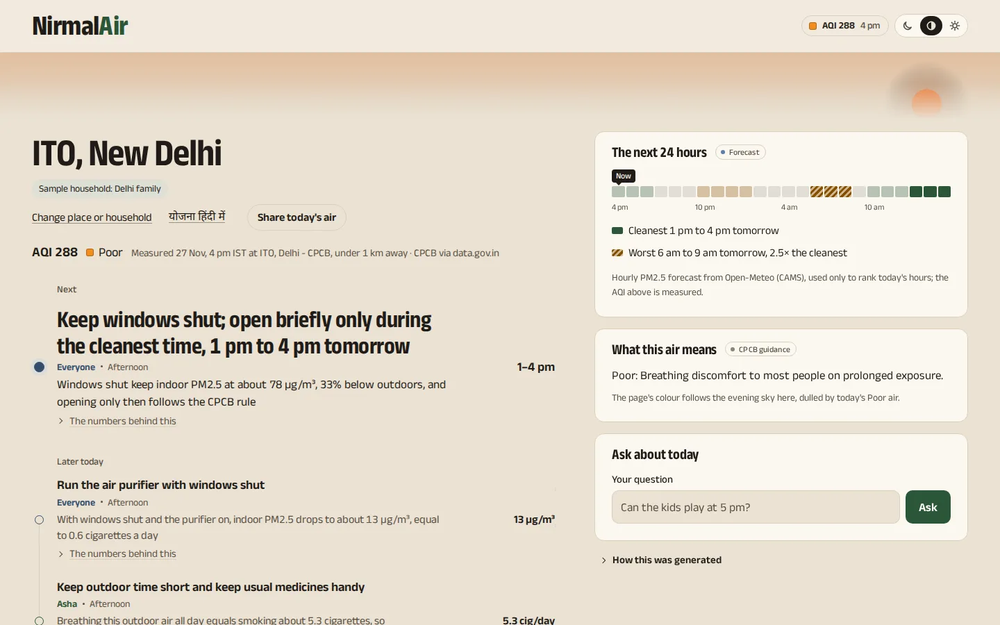
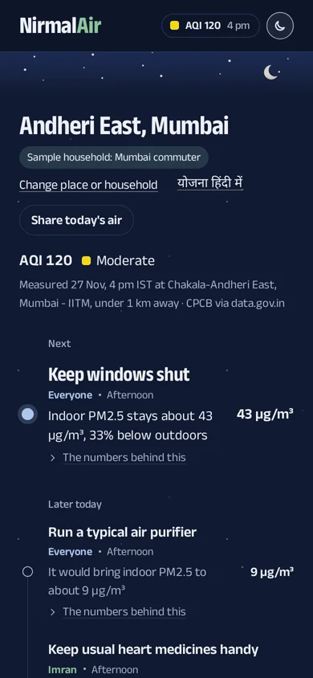
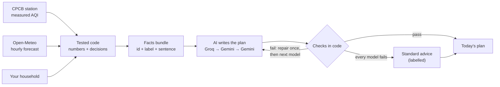

# NirmalAir

**Today's measured air, turned into a plan for each person at home.**

[](https://github.com/Mitali-Patle/nirmal-air/actions/workflows/ci.yml)
[](https://github.com/Mitali-Patle/nirmal-air/actions/workflows/codeql.yml)

NirmalAir is a GenAI clean-air assistant for Indian families living through winter smog. It
reads the official air quality at the nearest CPCB monitoring station and tells each household
what to do today and when: who should move their walk indoors, when to open the windows, which
commute swap saves CO₂. It also says what each choice changes, with numbers worked out in code
rather than by the AI.

**Live app: https://nirmal-air.vercel.app** · no sign-up, works on any phone or laptop.

<p>
  
  
</p>

| Read more | |
|---|---|
| How it is built, security and efficiency | [docs/ARCHITECTURE.md](docs/ARCHITECTURE.md) |
| Every constant and its published source | [docs/ASSUMPTIONS.md](docs/ASSUMPTIONS.md) |
| Prompt versions, and how AI was used to build this | [PROMPTS.md](PROMPTS.md) |
| Product brief and design system | [PRODUCT.md](PRODUCT.md) · [DESIGN.md](DESIGN.md) |

## Try it in two minutes

1. Open the [live app](https://nirmal-air.vercel.app) and pick **Delhi family**.
2. Read the plan: the next step is set large, each step names who it is for and shows its
   figure on the right. Open **The numbers behind this** on any step to see its sources.
3. Open **How this was generated** to see the model, the prompt version, the facts sent and
   the raw reply.
4. Ask **"Can Aarav play cricket at 5 pm?"**, then something off-topic such as
   **"Write me a poem"**.
5. Tap **योजना हिंदी में** for the plan in Hindi, **Share today's air** for a summary to paste into a
   building or school group, and the moon, half circle and sun at the top for dark, follow the
   sky, and light colours.
6. Go back with **Change place or household** and type your own place: "Lucknow", "Salt Lake",
   "Gurgaon", or "Nirmal" (its nearest station is about 110 km away, and the page says the local
   air may differ). Try a place that does not exist, or a routine for someone not in the
   household, to see the errors.

| Sample | What it shows |
|---|---|
| **Delhi family** (ITO, New Delhi) | A child's outdoor play and a grandmother's walk with asthma moved indoors on Poor or worse air. A car commute with a metro option. Purifier and incense. |
| **Bengaluru cyclist** (Koramangala) | A single adult whose cycle commute has no CO₂ to swap; on cleaner days the routines stay as they are |
| **Mumbai commuter** (Andheri East) | A father with a heart condition: offered the carpool, not the bus, because the bus adds polluted air on the way. A daughter's school run. |

Readings are live, so the plan changes with the day's air and the time of day.

## Chosen vertical

**Urban Air Quality Assistant.** The brief: help families and communities through winter smog
with low-emission daily routines, indoor air-quality steps and sustainable alternatives, suited
to their location and lifestyle, and explain the direct impact of each choice.

| What the brief asks for | Where NirmalAir does it |
|---|---|
| Real-time data, with its source and time | The nearest CPCB station's AQI, with station, distance, measured time and source on screen; never written by the AI |
| Low-emission daily routines | A plan step for each person's routine, timed against the next 24 hours' cleanest and worst hours; errands done in one outing, in the cleanest time |
| Indoor air-quality steps | The windows rule, purifier and indoor-source steps (incense, coils, smoking, solid fuel), indoor PM2.5 estimates, and an honest answer on houseplants (they do not measurably clean a room's air) |
| Sustainable alternatives | Commute swaps (bus, metro, cycle, walk, carpool) with CO₂ saved per week and the change in polluted air breathed on the way |
| Location | Any place in India, by name or by "Use my location"; the page's colour follows that place's sky |
| Lifestyle | Up to eight people with age group and sensitivities (asthma or lung, heart, pregnancy), routines, commutes and the home; "Change place or household" reopens the saved household for editing |
| Direct impact of each choice | A figure on every step, the facts behind it one tap away, and a "This week" log that adds up what the household actually did |
| Families and communities | "Share today's air" copies a short summary (AQI, measured time and station, cleanest and worst hours) for a family, building, school or society group |
| Other languages, any device | The plan and answers in Hindi; layouts from 320 px phones up, keyboard and screen-reader tested |

## Approach and logic

**AI explains, code calculates, real data decides.**

1. **Real data decides.** The air quality comes only from CPCB's real-time feed, from the
   nearest station that has a valid reading under 3 hours old. Its station, distance, time and
   source are always on screen. The forecast is used only to rank hours against each other.
2. **Code calculates.** Every number is computed by tested code: the AQI and its band, PM2.5,
   indoor estimates, cigarette equivalents, commute CO₂ and the polluted air breathed on the
   way. Code also makes the decisions: whether a routine moves indoors or to the cleanest
   time, the windows rule, and which swap to offer. Someone with a heart or lung condition is
   never offered a swap that makes them breathe more polluted air.
3. **AI explains.** The model receives a **facts bundle**: short sentences written by code,
   each with an id and a label (measured, forecast, estimate, CPCB guidance, your household).
   It writes the plan as JSON, citing fact ids. Code then checks every step (below). A
   rejected answer gets one repair attempt, then the next model, then rules-based advice
   labelled "Standard advice (not AI-generated)".



### GenAI in action: one real request

From the Delhi family's plan on 27 November (abridged; the page shows all of it under "How
this was generated"). Code sent 20 facts, including:

```text
air_now          AQI 288 (Poor) at ITO, Delhi - CPCB, under 1 km away, measured at 4 pm. Main pollutant: PM2.5.
cleanest         Cleanest time: 1 pm to 4 pm tomorrow.
windows          Today's rule for windows on Poor air: keep windows shut; open them briefly only during the cleanest time, 1 pm to 4 pm tomorrow.
routine_1        Aarav's usual outdoor play: 5 pm, for 60 minutes. Today's rule for Poor air and a more sensitive person: move it indoors today.
indoor_shut      With windows shut, the main room is about 78 µg/m³, 33% below outdoors.
indoor_purifier  With windows shut and the purifier on, about 13 µg/m³: about 0.6 cigarettes a day instead of about 5.3 outdoors.
```

Groq `openai/gpt-oss-120b` replied (prompt `plan-v7`, 4.4 s):

```json
{"member": "Everyone", "slot": "afternoon",
 "action": "Keep windows shut; open briefly only during the cleanest time, 1 pm to 4 pm tomorrow",
 "why": "Windows shut keep indoor PM2.5 at about 78 µg/m³, 33% below outdoors, and opening only then follows the CPCB rule",
 "fact_ids": ["windows", "cleanest", "indoor_shut"]}
```

Every number in it (78, 33, 1 pm, 4 pm) is in a cited fact. Before a step is shown, code
checks that:

- every number, including number words such as "twice" or "तीन", appears in the facts;
- each step names a real household member (or "Everyone") and cites real fact ids;
- every sensitive person and every routine and commute gets a step;
- each commute's swap chosen by code is offered;
- the cleanest time is quoted whole, and says "tomorrow" when it is;
- a Hindi plan is actually written in Devanagari.

A failed check is sent back to the model with the exact problem ("item 2: say the cleanest
time is tomorrow"), and the attempt is listed on the page.

## How the solution works

1. **Pick a household.** Choose one of three samples, or describe your own. Then search for a
   place (older names such as Bangalore or Gurgaon work) or use your location. Nothing is
   stored on a server: the household lives in a signed, HttpOnly cookie, which "Forget this
   household" clears.
2. **Measured air.** The app finds the nearest CPCB stations from a stored list of 571. It
   asks the nearest first, and the next two only if needed. It works out the official AQI
   (the highest sub-index, valid only with at least three pollutants including PM2.5 or PM10).
3. **Timing.** The Open-Meteo (CAMS) hourly forecast for the next 24 hours finds the cleanest
   and worst 3-hour windows between 6 am and 10 pm, drawn as a strip of hours.
4. **Facts and decisions.** Code builds the facts bundle and the rules for routines, windows
   and swaps.
5. **The plan.** The AI chain (Groq `openai/gpt-oss-120b`, then Gemini 3.5 Flash-Lite, then
   Gemini 3.1 Flash-Lite) writes the plan. The page draws it as the day's timeline: the next
   step largest, a dot for each person's step (blue for the home) and its figure at the right
   edge. The plan loads after the page, so the measured air is on screen at once.
6. **Ask.** The Ask box answers questions such as "Can the kids play at 5 pm?" from the same
   facts, under the same number guard, asks back when a question is too vague, and declines
   off-topic requests.
7. **This week.** Tick "I did this" on today's commute swap or a routine moved indoors. Code
   works out that day's CO₂ avoided and the change in PM2.5 breathed, from that day's
   measured air, and the panel adds up the last seven days.
8. **Share.** "Share today's air" copies a summary built by code (never by the AI) for a
   family, building, school or society group, or opens the phone's share sheet.
9. **The sky.** The page's colour follows the time of day at the place (morning, afternoon,
   evening, dusk, night), from sunrise and sunset computed in code, and is dulled toward smog
   by the measured AQI band. A sky band at the top draws the sun on its real path (or the moon
   and stars at night, fewer through smog), clouds from the real cloud cover, and rain when it
   rains. It is decoration only, never carries text, and stops moving for reduced motion. A
   switch in the top bar pins dark or light colours without reloading the page.

## Built for the evaluation criteria

| Criterion | What to look at |
|---|---|
| **Code quality** | Typed Python (mypy strict), small modules (every app file under 300 lines), pure domain code that imports nothing else from the app, docstrings with doctests, ruff with a wide rule set, pre-commit and CI on every push |
| **Security** | Strict Content Security Policy with no inline code, HSTS, CSRF tokens on every POST, a signed HttpOnly SameSite cookie, rate limits on every route (tighter for AI), 16 KB request cap, validated inputs, user text sent to the model as data, keys only in environment variables; gitleaks, pip-audit and CodeQL in CI. Details: [ARCHITECTURE.md](docs/ARCHITECTURE.md#security) |
| **Efficiency** | Air and forecast fetched side by side; nearest station first; caches for readings, forecasts, places and identical AI requests; a failing source is not asked again for two minutes; no front-end framework (htmx plus four small scripts); self-hosted fonts. Details: [ARCHITECTURE.md](docs/ARCHITECTURE.md#efficiency) |
| **Testing** | 360 tests with 100% branch coverage (gate 95%), 37 browser tests, and every outside service mocked with recorded replies |
| **Accessibility** | axe checks for WCAG 2.2 AA on every page in light and dark, keyboard-only and 320 px tests, a skip link, visible focus, reduced motion respected, text contrast tested in every sky colour at every haze level |

## Assumptions

- CPCB's `avg_value` in the data.gov.in feed is each pollutant's **sub-index** on the AQI
  scale, not a concentration. PM2.5 concentration is worked back from CPCB's breakpoints.
- Indoor PM2.5 is a steady-state estimate from outdoor air only, with published typical values
  for leakage, settling and air exchange. Cooking, incense and smoking make real rooms worse.
- Commute CO₂ factors come from the India GHG Program (2015). Exposure on the way, speeds and
  breathing rates come from a Delhi on-road study (Goel et al., 2015) and are applied to all
  cities. Metro CO₂ is from the Delhi Metro (61 g per passenger-km).
- The forecast is a regional model (about 45 km). Its values are never shown as the air
  quality, only used to rank hours.
- "Equal to N cigarettes" uses Berkeley Earth's 22 µg/m³ of PM2.5 for a day ≈ one cigarette.
- Houseplants: an indoor study review (Cummings and Waring, 2019) found that it would take
  10 to 1,000 plants per square metre to match a building's normal air exchange.

Every value, with its source and caveats: [docs/ASSUMPTIONS.md](docs/ASSUMPTIONS.md).

## Data sources

- **Central Pollution Control Board**, real-time air quality, via
  [data.gov.in](https://www.data.gov.in/resource/real-time-air-quality-index-various-locations)
  (Government Open Data License, India).
- **[Open-Meteo](https://open-meteo.com/)**: air-quality forecast (CAMS, CC BY 4.0), place
  search, and current cloud cover and rain for the sky drawing.
- Published sources for every constant are listed in [docs/ASSUMPTIONS.md](docs/ASSUMPTIONS.md).

## Limitations

- No accounts or cross-device sync; the household lives in one browser's cookie. The cookie
  is signed (it cannot be altered) but not encrypted: whoever holds the browser can decode it.
  "Forget this household" on the start page clears it, for a shared device.
- No indoor sensors: indoor values are estimates from outdoor air.
- Tailpipe PM2.5 per trip is not estimated (no current Indian per-kilometre data for today's
  vehicles).
- The number guard proves every number (and number words such as "twice" or "half") came from
  the facts, not that the AI used it in the right place. Each step shows the facts it cites
  so a reader can check.
- Hindi covers the AI's plan and answers only; the interface and the rules-based standard
  advice stay in English, and say so.
- Not medical advice: the app says when to keep medicines handy or see a doctor, nothing more.
- Free model quotas are limited. When every model is busy, the page shows labelled standard
  advice instead.
- A step ticked in "This week" cannot be un-ticked; it can only be logged once a day.
- Place search is in English letters (the geocoder does not match Devanagari names).

## Run it locally

Needs Python 3.12 and [uv](https://docs.astral.sh/uv/).

```bash
uv sync
cp .env.example .env      # add DATA_GOV_API_KEY, GROQ_API_KEY, GEMINI_API_KEY
uv run uvicorn app.index:app --reload
```

Without keys the app still runs: it says when no measured reading is available and shows the
labelled standard advice.

## Quality checks

```bash
uv run ruff check . && uv run ruff format --check .
uv run mypy app tests scripts                  # strict
uv run pytest -W error --cov=app               # 360 tests, 95% branch-coverage gate (100% now)
uv run pytest -W error -m e2e                  # 37 browser tests: axe (WCAG 2.2 AA), widths, keyboard
```

CI runs the same checks plus a secret scan, a dependency audit and a repository-size budget
on every push, and CodeQL scans the Python and JavaScript. There is no Dependabot: its update
pull requests would add branches, and this repository keeps exactly one; pip-audit fails CI
on any known-vulnerable dependency instead. The tests never call a real service: CPCB,
Open-Meteo and the AI models are mocked with recorded replies.

## Project layout

| Path | What it holds |
|---|---|
| `app/air/` | CPCB, forecast and place-search clients; nearest-station lookup |
| `app/domain/` | Pure calculations: AQI, household, commute, indoor air, timing, sky, decision rules; imports nothing else from the app |
| `app/advice/` | The facts bundle, the plan and Ask tasks, and the standard advice |
| `app/ai/` | Model providers, the fallback chain and the number guard |
| `app/services/` | Today's data for a place and household, and the sample households |
| `app/web/` | Routes, typed dependencies, session, rate limits, security headers, templates |
| `public/static/` | CSS, self-hosted fonts, htmx and four small scripts |
| `tests/` | Unit, web and browser tests, with recorded replies from every outside service |
| `docs/` | Architecture, assumptions and screenshots |
