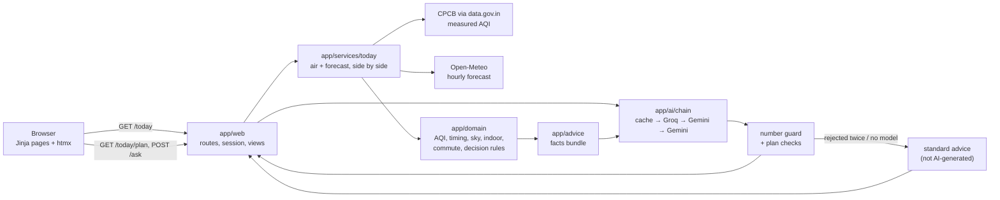

# Architecture

One FastAPI app on Vercel (Mumbai region), server-rendered with Jinja and htmx. No database:
the household lives in a signed cookie, and data and AI answers are cached in memory.

## Request flow

1. `GET /today` reads the household from the signed cookie. It fetches the measured air
   (nearest valid CPCB station) and the 24-hour forecast at the same time, then renders the
   air, the route strip and the estimates at once.
2. The page asks for `GET /today/plan` through htmx. The plan is the slow part (an AI call),
   so the rest of the page never waits for it.
3. The plan route builds the facts bundle, then runs the AI chain:
   - a cached answer for an identical request, if one exists;
   - otherwise each model in order, each answer validated against a JSON schema and checked
     (number guard, real fact ids, every sensitive member and routine covered);
   - one repair attempt per model, with the problems listed;
   - rules-based standard advice if every model fails.

   The chain records every attempt, which the page shows as "How this was generated".
4. `POST /ask` does the same with the question added to the request, as a JSON string.

## Boundaries

| Layer | May do | May not do |
|---|---|---|
| `app/domain` | Calculations and decisions, pure and tested | Network, AI, templates |
| `app/air` | Fetch and parse CPCB, Open-Meteo and the station list | Decide anything |
| `app/advice` | Turn data into facts; define the AI tasks and standard advice | Call a model directly |
| `app/ai` | Call models, validate, guard, fall back, cache, record provenance | Know about air quality |
| `app/web` | Routes, session, CSRF, views, templates | Compute numbers |

## Security

- **Strict Content Security Policy:** scripts, styles, fonts and images come from the app's
  own origin only, with no inline code. HSTS and frame denial in production.
- **Cookie:** signed, HttpOnly and SameSite=Lax, holding only the household profile (no
  account, no server-side personal data). CSRF tokens on every POST.
- **Inputs:** every input is validated with limits. Member names accept letters only, so
  nothing typed can carry instructions to the AI. Place names come from the geocoder, never
  from the form. Questions reach the model as a JSON string and are treated as data.
- **Secrets:** keys live only in environment variables. Gitleaks runs in pre-commit and CI,
  and pip-audit checks dependencies.

## Efficiency

- The nearest station is asked first, and the next two only when it has no valid reading.
  Station readings are cached for 15 minutes. When CPCB stops answering, the last cached
  reading is reused and labelled as such, as long as it was measured in the last 3 hours.
- The forecast is cached per place for an hour, and identical AI requests for an hour.
- The air and the forecast are fetched concurrently. The plan loads after the page, so
  the first paint never waits for a model.
- No front-end framework: htmx (52 KB, vendored) and one small script for "Use my location".
