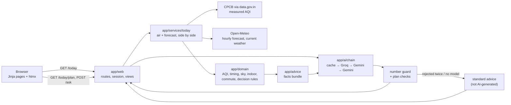

# Architecture

One FastAPI app on Vercel (Mumbai region), server-rendered with Jinja and htmx. No database:
the household lives in a signed cookie, and data and AI answers are cached in memory.

## Request flow

1. `GET /today` reads the household from the signed cookie. It fetches the measured air
   (nearest valid CPCB station) and the 24-hour forecast at the same time, then renders the
   air, the route strip and the estimates at once.
2. The page asks for `GET /today/plan` through htmx. The plan is the slow part (an AI call),
   so the rest of the page never waits for it.
3. The plan route builds the facts bundle, then runs the AI chain:
   - a cached answer for an identical request, if one exists;
   - otherwise each model in order, each answer validated against a JSON schema and checked
     (number guard, real fact ids, every sensitive member and routine covered);
   - one repair attempt per model, with the problems listed;
   - rules-based standard advice if every model fails.

   The chain records every attempt, which the page shows as "How this was generated".
4. `POST /ask` does the same with the question added to the request, as a JSON string.

## Boundaries

| Layer | May do | May not do |
|---|---|---|
| `app/domain` | Calculations and decisions, pure and tested | Network, AI, templates |
| `app/air` | Fetch and parse CPCB, Open-Meteo and the station list | Decide anything |
| `app/advice` | Turn data into facts; define the AI tasks and standard advice | Call a model directly |
| `app/ai` | Call models, validate, guard, fall back, cache, record provenance | Know about air quality |
| `app/web` | Routes, session, CSRF, views, templates | Compute numbers |

Imports only point inwards: `app/domain` imports nothing else from the app, so the shared
vocabulary (India time, pollutants, forecast hours) lives in `app/domain/readings.py` and the
clients in `app/air` build it. `tests/test_architecture.py` fails the build if a layer imports
one it may not. Routes reach the app's services through one typed object (`app/web/deps.py`),
and outside-service failures share one base error, `UpstreamUnavailableError`.

## Security

What the app holds, where it is sent, every control with the file that implements it, and the
risks accepted: [SECURITY.md](../SECURITY.md). In short: a strict CSP with no inline code, a
signed HttpOnly cookie as the only storage, CSRF tokens on every POST, validated inputs with a
16 KB body limit, per-client rate limits on every route (tighter for AI), the number guard on
every AI answer, and keys only in environment variables.

## Efficiency

- The nearest station is asked first, and the next two only when it has no valid reading.
  Station readings are cached for 15 minutes. When CPCB stops answering, the last cached
  reading is reused and labelled as such, as long as it was measured in the last 3 hours.
- The current weather (for the sky drawing only) is cached per place for 30 minutes and has
  a 2-second timeout, so decoration never holds the page up.
- A source that just failed (a CPCB station, the forecast, the weather) is not asked again
  for two minutes, so an outage costs one timeout, not one per request. When every model
  fails, the labelled standard advice is reused for a minute for the same request.
- The forecast is cached per place for an hour, with an older copy (up to 3 hours) used when
  Open-Meteo does not answer. Place searches are cached for a day. Identical AI requests are
  cached for an hour, and identical requests arriving together share one model call.
- The air and the forecast are fetched concurrently. The plan loads after the page, so
  the first paint never waits for a model.
- No front-end framework: htmx (52 KB, vendored) and four small scripts: "Use my location",
  the colour switch, "Share today's air", and the message shown when a request fails or
  times out (28 s), so nothing waits for ever.
- Fonts: one Latin file for every page; the Hindi font loads only where Hindi text is shown.
